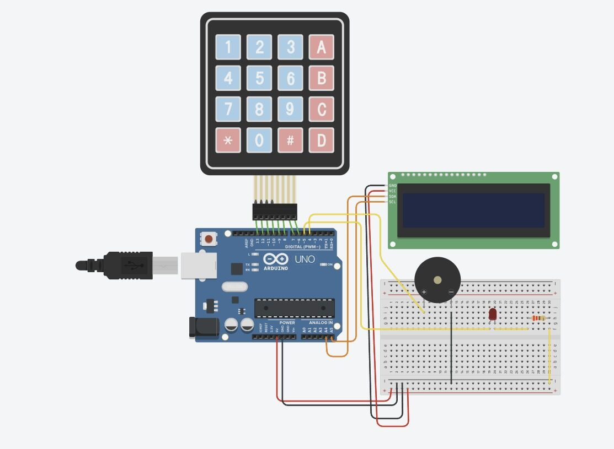
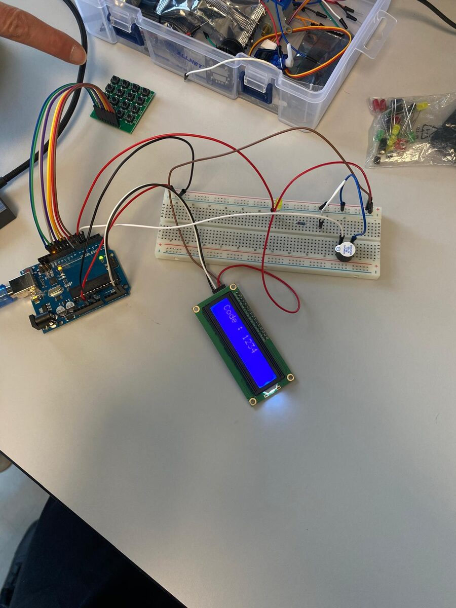
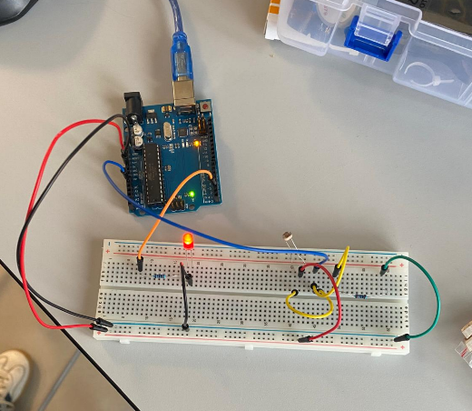
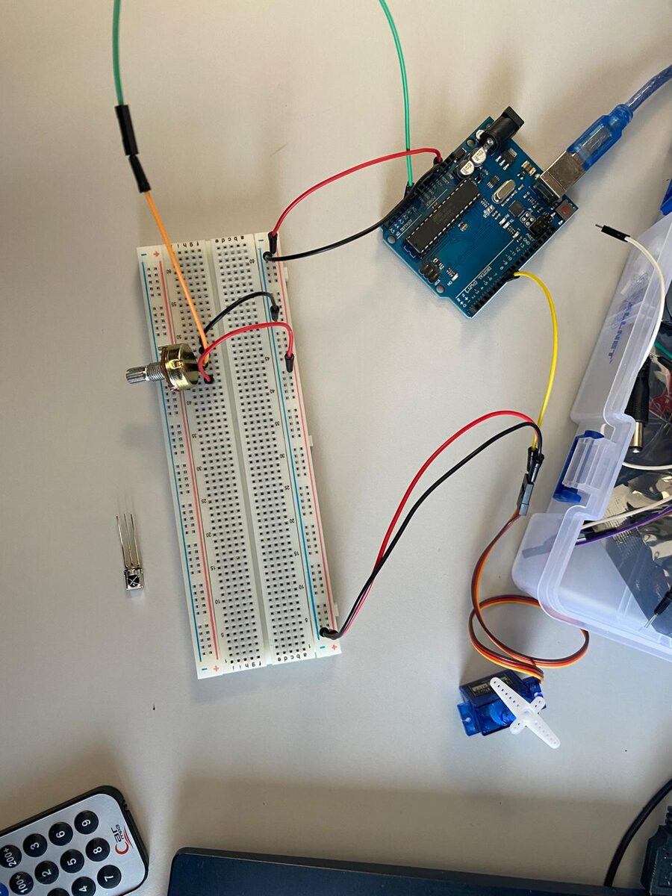
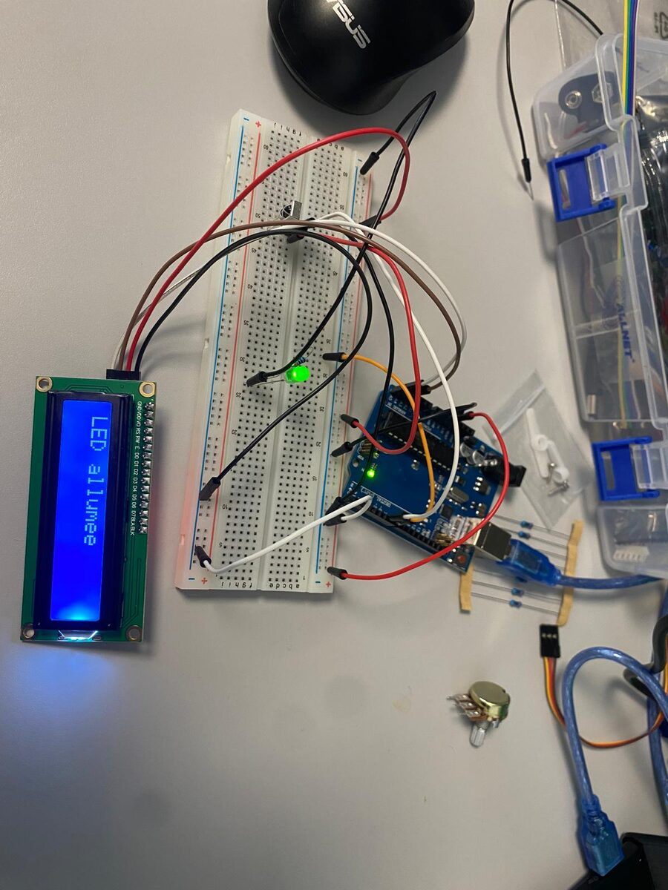
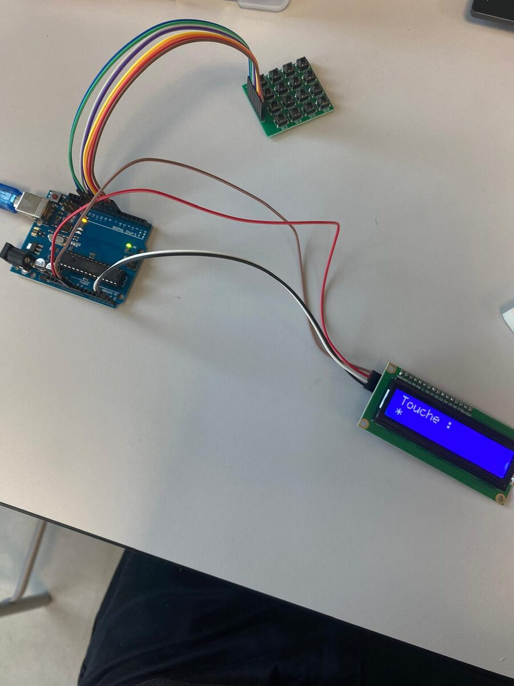
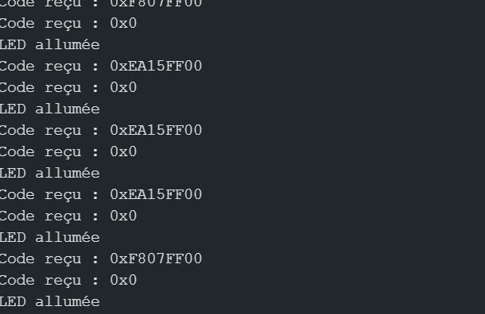

# Projets Arduino — du capteur au digicode

Série de montages **Arduino (C++)** réalisés en Bachelor 1 à l'IPSA (cours d'électronique), en binôme.
L'objectif : prendre en main des composants un par un, puis les combiner dans des systèmes de plus en plus complets, jusqu'à un **digicode d'immeuble** avec code gardien et retour sonore.

Démarche suivie pour chaque montage : **lecture des datasheets → simulation sur Tinkercad → câblage réel → code et débogage.**

---

## Contenu

| # | Projet | Composants | Notions |
|---|---|---|---|
| 01 | [LED pilotée par la lumière](01_led_photoresistance) | Photorésistance (LDR), LED | Entrée analogique, seuil, moniteur série |
| 02 | [Servomoteur au potentiomètre](02_servo_potentiometre) | Servomoteur SG90, potentiomètre | PWM, `map()`, bibliothèque `Servo` |
| 03 | [Télécommande IR + écran LCD](03_telecommande_ir_lcd) | Récepteur infrarouge, télécommande, LCD 16x2 I2C, LED | Décodage IR, bus I2C, affichage |
| 04 | [Clavier matriciel + LCD](04_clavier_matriciel_lcd) | Clavier 4x4, LCD 16x2 I2C | Balayage lignes/colonnes, bibliothèque `Keypad` |
| 05 | [Digicode](05_digicode) | Clavier 4x4, LCD, LED | Saisie de code, temporisation non bloquante avec `millis()` |
| 06 | [Digicode avec code gardien et buzzer](06_digicode_gardien_buzzer) | Clavier 4x4, LCD, LED, buzzer actif | Machine à états (mode normal / mode gardien), code modifiable, signaux sonores |

## Projet phare : le digicode (06)

Simulation d'un digicode d'immeuble :

- Code à 4 chiffres → **« Accès autorisé »**, LED allumée 5 secondes, double bip
- Mauvais code → **« Mauvais code ! »**, bip long
- **Code gardien** (`0000`) → passe en mode gardien pour **changer le code** des habitants, confirmé par trois bips
- Extinction automatique de la LED gérée avec `millis()` (sans bloquer la lecture du clavier)

| Simulation Tinkercad | Montage réel |
|---|---|
|  |  |

## Les autres montages

| 01 — LED + photorésistance | 02 — Servo + potentiomètre |
|---|---|
|  |  |

| 03 — Télécommande IR + LCD | 04 — Clavier matriciel + LCD |
|---|---|
|  |  |

Pour le montage 03, un premier programme a servi à **lire les codes hexadécimaux** envoyés par chaque touche de la télécommande (moniteur série), avant de les utiliser dans le code final :

## Utiliser les codes

1. Ouvrir le fichier `.ino` d'un dossier dans l'**Arduino IDE**
2. Installer les bibliothèques nécessaires via *Outils → Gérer les bibliothèques* :
   - `LiquidCrystal_I2C` (écran LCD, adresse I2C `0x27`)
   - `Keypad` (clavier matriciel)
   - `IRremote` (récepteur infrarouge)
   - `Servo` (incluse par défaut)
3. Téléverser sur une carte **Arduino Uno**

Brochage du clavier 4x4 (montages 04 à 06) : lignes sur les pins 13, 12, 11, 10 — colonnes sur 9, 8, 7, 6. LED sur la pin 5, buzzer sur la pin 4.

## Ce que j'ai appris

- Lire une datasheet pour comprendre un composant avant de le câbler
- Simuler sur Tinkercad avant de passer au montage physique
- Utiliser des bibliothèques Arduino et des protocoles de communication (I2C, infrarouge)
- Structurer un programme en états et gérer le temps sans `delay()` bloquant
- Déboguer méthodiquement avec le moniteur série

## Contact

**Timothé Bardoux** — étudiant ingénieur à l'IPSA · [Mon profil GitHub](https://github.com/tbardoux)
